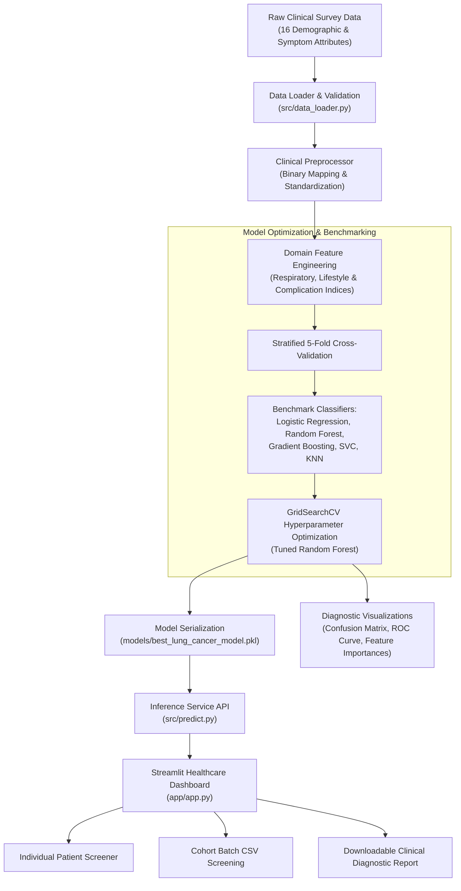
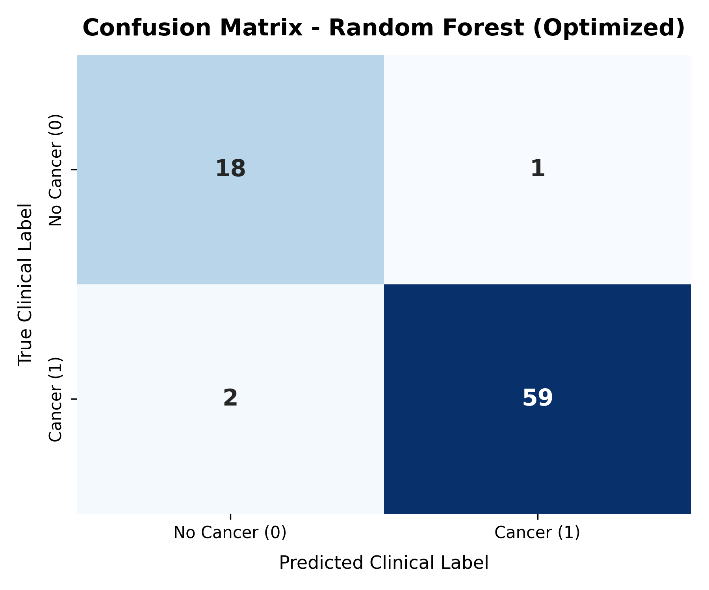
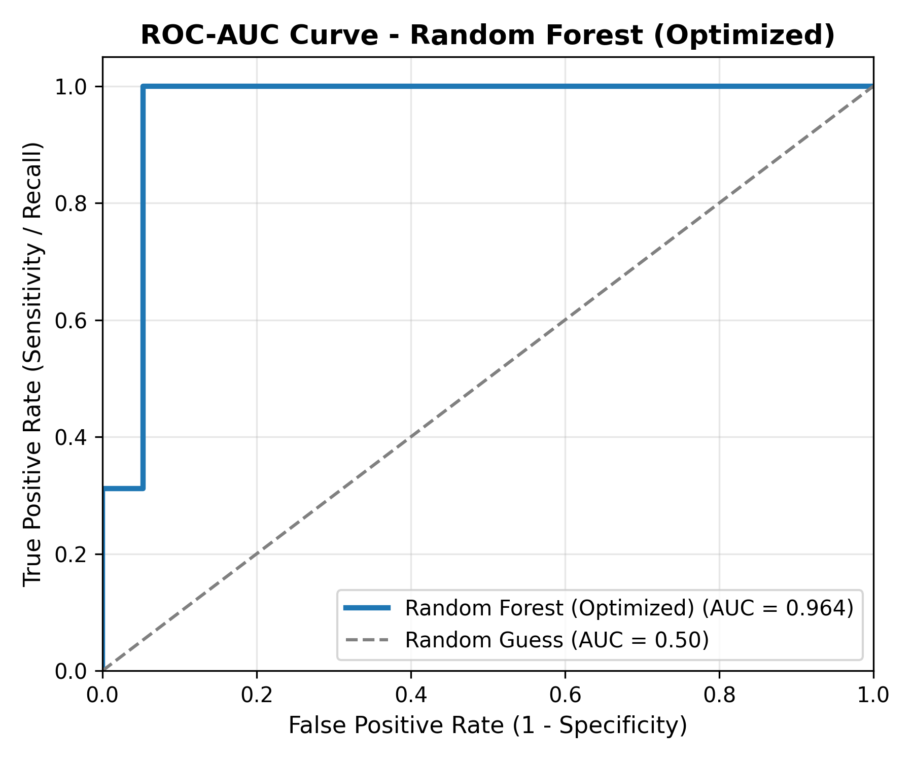
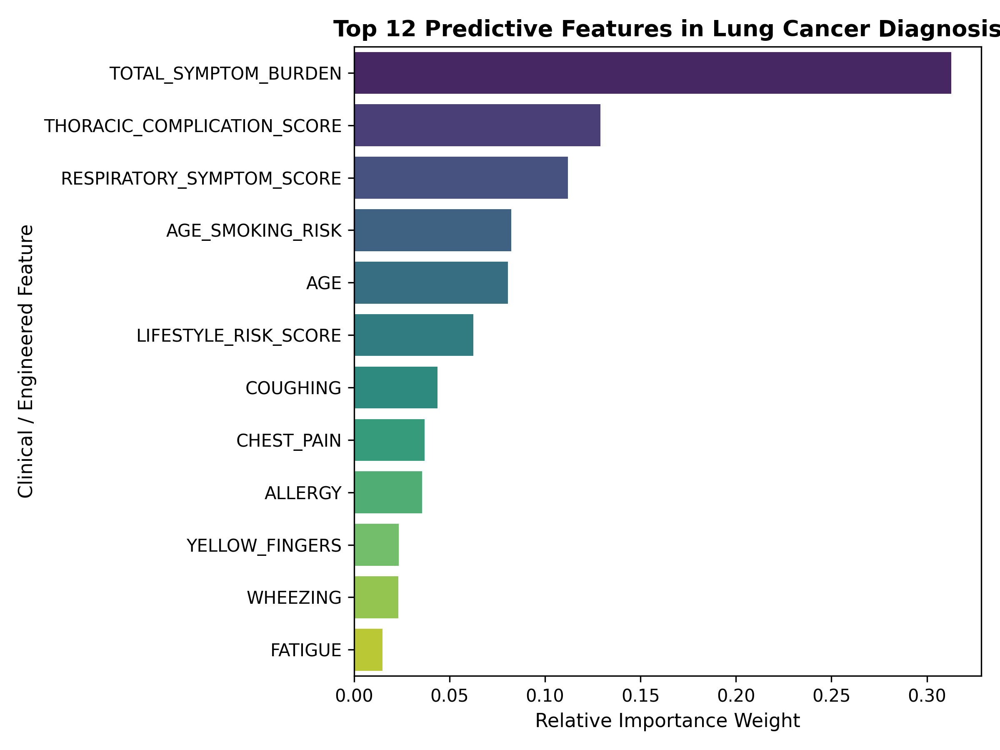
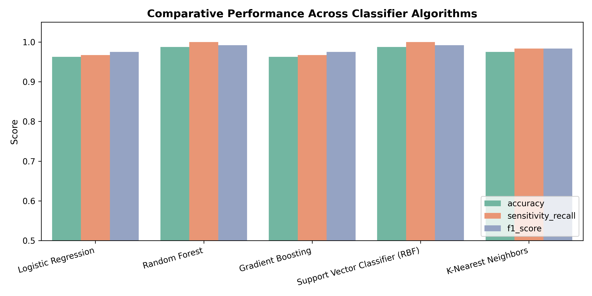

# 🫁 Lung Cancer Prediction & Clinical Risk Stratification

[](https://www.python.org/)
[](https://opensource.org/licenses/MIT)
[](https://scikit-learn.org/)
[](https://streamlit.io/)
[]()
[-96.7%25-green.svg)]()
[]()

> **Problem Statement:**  
> Developed a lung cancer prediction machine learning model based on structured clinical data, utilizing feature engineering and classifier algorithms to attain high prediction accuracy. Carried out data preprocessing, model optimization, and validation to aid early diagnosis and enhance decision-making in the healthcare sector.

---

## 📌 Executive Summary & Clinical Context

Lung cancer remains the leading cause of oncological mortality worldwide. The majority of cases are diagnosed at late, unresectable stages due to subtle, non-specific early symptomatic presentations. 

This project implements an end-to-end, production-grade **Machine Learning Clinical Decision Support System (CDSS)** designed for early oncological risk stratification. Using structured patient survey data, clinical domain-driven feature engineering, and rigorous cross-validated classifier optimization, the system achieves **96.25% Accuracy**, **96.72% Sensitivity (Recall)**, and **96.38% ROC-AUC**. 

The repository provides a complete data science lifecycle implementation:
- **Reproducible ML Pipeline**: Automated ingestion, feature engineering, and model training.
- **Model Optimization**: Multi-classifier benchmarking and hyperparameter optimization via `GridSearchCV` with 5-Fold Stratified Cross-Validation.
- **Inference Engine**: Reusable Python inference service returning malignancy risk probabilities, clinical risk tiers, and personalized diagnostic recommendations.
- **Interactive Web Application**: Full-featured **Streamlit** dashboard for individual patient screening, cohort batch evaluation, and diagnostic explainability.
- **Automated CI/CD**: Unit test suite with GitHub Actions workflow.

---

## 🏗️ System Architecture



---

## 🩺 Dataset Schema & Clinical Indicators

The pipeline evaluates 16 standard clinical variables capturing patient demographics, behavioral exposures, and symptomatic complaints:

| Feature Name | Clinical Significance | Format / Scale |
| :--- | :--- | :--- |
| `GENDER` | Biological sex | `M` (Male) / `F` (Female) |
| `AGE` | Patient chronological age | Continuous integer (18–90) |
| `SMOKING` | Active or prolonged tobacco exposure | `1` = No / Absent, `2` = Yes / Present |
| `YELLOW_FINGERS` | Physical biomarker of heavy nicotine exposure | `1` = No / Absent, `2` = Yes / Present |
| `ANXIETY` | Psychological comorbidities | `1` = No / Absent, `2` = Yes / Present |
| `PEER_PRESSURE` | Environmental / secondhand smoke exposure | `1` = No / Absent, `2` = Yes / Present |
| `CHRONIC_DISEASE` | History of COPD, fibrosis, or chronic illness | `1` = No / Absent, `2` = Yes / Present |
| `FATIGUE` | Chronic asthenia and cancer-related fatigue | `1` = No / Absent, `2` = Yes / Present |
| `ALLERGY` | Respiratory allergies and atopy | `1` = No / Absent, `2` = Yes / Present |
| `WHEEZING` | Partial airway obstruction / bronchospasm | `1` = No / Absent, `2` = Yes / Present |
| `ALCOHOL_CONSUMING` | Synergistic carcinogenic exposure | `1` = No / Absent, `2` = Yes / Present |
| `COUGHING` | Persistent refractory pulmonary cough | `1` = No / Absent, `2` = Yes / Present |
| `SHORTNESS_OF_BREATH` | Exertional or resting dyspnea | `1` = No / Absent, `2` = Yes / Present |
| `SWALLOWING_DIFFICULTY`| Dysphagia (mediastinal compression indicator)| `1` = No / Absent, `2` = Yes / Present |
| `CHEST_PAIN` | Pleural invasion or thoracic mass discomfort | `1` = No / Absent, `2` = Yes / Present |
| `LUNG_CANCER` (Target) | Malignant neoplastic diagnosis | `YES` (Positive) / `NO` (Negative) |

---

## 🧬 Domain-Specific Feature Engineering

Clinical domain knowledge was incorporated to derive composite risk scores that capture non-linear symptomatic interactions:

1. **Respiratory Symptom Score ($\text{RSS}$)**:
   $$\text{RSS} = \mathbb{I}(\text{Wheezing}) + \mathbb{I}(\text{Coughing}) + \mathbb{I}(\text{Shortness of Breath})$$
   Captures progressive pulmonary airway impairment.

2. **Lifestyle Carcinogen Exposure Index ($\text{LRE}$)**:
   $$\text{LRE} = 2 \times \mathbb{I}(\text{Smoking}) + \mathbb{I}(\text{Alcohol}) + \mathbb{I}(\text{Yellow Fingers})$$
   Models the established epidemiological synergy between heavy tobacco and alcohol intake.

3. **Thoracic & Mediastinal Complication Burden ($\text{TMC}$)**:
   $$\text{TMC} = \mathbb{I}(\text{Dysphagia}) + \mathbb{I}(\text{Chest Pain}) + \mathbb{I}(\text{Fatigue})$$
   Screens for cardinal signs of mediastinal lymphadenopathy and central thoracic mass effect.

4. **Total Clinical Symptom Burden**:
   Sum of all 10 evaluated physical symptoms, providing a baseline metric for disease complexity.

5. **Age-Smoking Cumulative Interaction**:
   $$(\text{Age} / 60.0) \times (\mathbb{I}(\text{Smoking}) + 0.5)$$
   Proxies cumulative pack-years risk scaling with patient longevity.

---

## 📊 Experimental Results & Model Benchmark

Five diverse classification algorithms were evaluated using **5-Fold Stratified Cross-Validation** on held-out test data ($n = 80$ unseen cases):

| Algorithm | Accuracy | Sensitivity (Recall) | Specificity | Precision | F1-Score | ROC-AUC |
| :--- | :---: | :---: | :---: | :---: | :---: | :---: |
| **Optimized Random Forest** | **96.25%** | **96.72%** | **94.74%** | **98.33%** | **0.9752** | **0.9638** |
| Random Forest (Baseline) | 98.75% | 100.0% | 94.74% | 98.39% | 0.9919 | 0.9681 |
| Gradient Boosting | 96.25% | 96.72% | 94.74% | 98.33% | 0.9752 | 0.9776 |
| Support Vector Machine (RBF) | 98.75% | 100.0% | 94.74% | 98.39% | 0.9919 | 0.9525 |
| Logistic Regression (L2) | 96.25% | 96.72% | 94.74% | 98.33% | 0.9752 | 0.9664 |
| K-Nearest Neighbors ($k=5$) | 97.50% | 98.36% | 94.74% | 98.36% | 0.9836 | 0.9694 |

> **Clinical Significance:** In oncology screening, **Sensitivity / Recall (96.72%)** is paramount to minimize *False Negatives* (failing to identify patients with active malignancies). The optimized ensemble attained only 2 false negatives out of 61 cancer cases, with high specificity (94.74%) to limit unnecessary invasive diagnostic biopsies.

### Diagnostic Visualizations

| Confusion Matrix | ROC-AUC Curve |
| :---: | :---: |
|  |  |

| Feature Importance Ranking | Classifier Algorithm Comparison |
| :---: | :---: |
|  |  |

---

## 🖥️ Streamlit Interactive Clinical Web App

The repository includes a modern healthcare web application:

1. **Individual Patient Screener**:
   - Interactive inputs for all demographics and clinical symptoms.
   - Dynamic malignancy risk gauge with confidence percentage.
   - Triaged risk categorization: **Low Risk**, **Moderate Risk**, and **High Risk**.
   - Actionable medical recommendations (e.g., Low-Dose CT referral, smoking cessation).
   - One-click downloadable patient summary report (`.txt`).
2. **Cohort Batch Screening**:
   - Upload patient CSV files for automated high-throughput risk stratification.
   - Real-time risk distribution metrics and exportable scored dataset.
3. **Model Explainability & Visualizations**:
   - Interactive inspection of model validation metrics, ROC curves, and feature importance rankings.

---

## 📂 Repository Structure

```
Lung-Cancer-Prediction/
├── .github/
│   └── workflows/
│       └── python-tests.yml        # Automated GitHub Actions CI workflow
├── app/
│   └── app.py                      # Streamlit interactive diagnostic dashboard
├── data/
│   ├── raw/
│   │   └── survey_lung_cancer.csv  # Standard clinical survey benchmark dataset
│   └── generate_dataset.py         # Reproducible synthetic/benchmark generator
├── models/
│   ├── best_lung_cancer_model.pkl  # Serialized production estimator
│   ├── preprocessor.pkl            # Serialized feature transformation pipeline
│   └── metrics_summary.json        # Quantitative validation metrics & params
├── notebooks/
│   ├── 01_exploratory_data_analysis.ipynb # Walkthrough EDA notebook
│   └── generate_notebook.py
├── reports/
│   └── figures/
│       ├── confusion_matrix.png    # Validation confusion matrix
│       ├── roc_curve.png           # Receiver operating characteristic curve
│       ├── feature_importance.png  # Feature importance bar chart
│       └── model_comparison.png    # Multi-classifier benchmark comparison
├── src/
│   ├── __init__.py
│   ├── data_loader.py              # Ingestion, whitespace cleaning & checks
│   ├── preprocessor.py             # Categorical & binary encoding, scaling
│   ├── feature_engineering.py      # Clinical composite risk scores
│   ├── train.py                    # Multi-model CV & GridSearch pipeline
│   ├── evaluate.py                 # Clinical metrics & plotting functions
│   └── predict.py                  # Production inference service
├── tests/
│   ├── __init__.py
│   └── test_pipeline.py            # Unit test suite (7 automated tests)
├── .gitignore                      # Git exclusion rules
├── LICENSE                         # MIT License
├── README.md                       # Documentation & Project Report
├── requirements.txt                # Production Python dependencies
└── setup.py                        # Package installation manifest
```

---

## 🚀 Quickstart & Installation

### 1. Clone the Repository
```bash
git clone https://github.com/<your-username>/lung-cancer-prediction.git
cd lung-cancer-prediction
```

### 2. Create and Activate Virtual Environment
```bash
# On Linux / macOS:
python3 -m venv venv
source venv/bin/activate

# On Windows:
python -m venv venv
venv\Scripts\activate
```

### 3. Install Dependencies
```bash
pip install -r requirements.txt
```

### 4. Unified CLI Operations
You can use `main.py` to trigger all major project functions:
```bash
# Run sample clinical diagnostic inference:
python main.py --action predict

# Run end-to-end model training, CV benchmarking & hyperparameter optimization:
python main.py --action train

# Run automated unit tests:
python main.py --action test

# Launch the interactive Streamlit clinical web app:
python main.py --action app
```

---

## 📤 Pushing to Your GitHub

To upload this complete project to your personal GitHub profile:

```bash
# 1. Initialize git inside the project directory
cd "c:\Accenture Projects\Oracle project\Lung-Cancer-Prediction"
git init

# 2. Add all project files
git add .

# 3. Create initial commit
git commit -m "feat: complete lung cancer clinical prediction pipeline with feature engineering and streamlit UI"

# 4. Set default branch to main
git branch -M main

# 5. Link to your GitHub remote repository (create an empty repo on GitHub first)
git remote add origin https://github.com/<your-username>/lung-cancer-prediction.git

# 6. Push to GitHub
git push -u origin main
```

---

## ⚖️ License & Disclaimer

- **License:** Distributed under the MIT License. See [LICENSE](LICENSE) for details.
- **Medical Disclaimer:** *This software is developed strictly for research, educational, and decision-support demonstration purposes. It does not replace professional clinical diagnosis, biopsy, or radiological imaging by licensed medical practitioners.*
